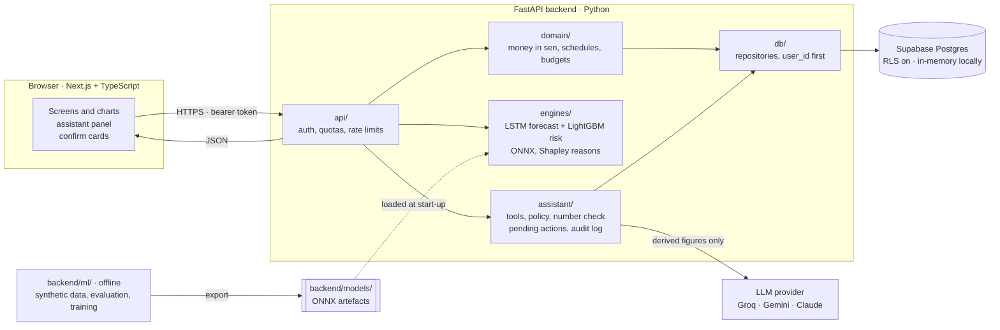

<div align="center">


# PaySense

**Think before you split.**<br>
An AI assistant that tells Malaysian university students whether a buy-now-pay-later plan fits their money before they commit, using only their own records.

<p>
     
</p>

<sub>built with</sub>

<p>
  
  
  
  
  
  
  
</p>

<p>
  
  
  
  
  
</p>

<p>
  
  
  
  
  
  
  
</p>

<p>
  
  
  
  
  
  
  
</p>

<sub>FinTechathon 2026 · Topic A: AI assistant for personal finance · Team Dang Wangi, Universiti Teknologi PETRONAS</sub>

</div>

---

PaySense helps Malaysian university students decide whether a buy-now-pay-later (BNPL) plan fits *before* they commit. It forecasts the student's money from their own records, scores the risk of a proposed plan, explains why, and lets them ask an AI assistant in plain words. The assistant reads and works things out through the app's own tools; it never makes up a figure and never changes anything until the student presses **Confirm**.

Built for the FinTechathon (Topic A: an AI assistant for personal finance) from PaySense v2, a Final Year Project (BSc (Hons) Computer Science, Universiti Teknologi PETRONAS). See [`CREDITS.md`](CREDITS.md).

Repository: [github.com/farahjayy/PaySense-v3](https://github.com/farahjayy/PaySense-v3)

> PaySense gives estimates from a student's own records. It is **not financial advice and not a credit decision**.

## What it does

| | |
|---|---|
| **Financial health forecast** | Places known income, bills and instalments on their dates, forecasts the variable part with a global LSTM (chosen over ARIMA, Prophet and simple benchmarks), and simulates 1,000 futures: a running-margin chart with an 80% band, a health score and the chance of running short. A savings buffer the student enters is counted; nothing else is assumed. |
| **BNPL risk check** | For a purchase on SPayLater, TikTok PayLater, Atome or any other provider: the exact instalment schedule from the provider's rules, a Safe / Caution / At Risk band from a calibrated LightGBM model (chosen over random forest, XGBoost and logistic regression), the reasons (exact Shapley values), and the smallest change that reaches Safe, or an honest "none does". |
| **Assistant** | Chat or quick actions. Three permission tiers: read, compute or propose, and write — writes only from a proposal the student confirms on a card built from the stored proposal. Every figure in its answer is checked against the tools' results. Works with Groq, Gemini or Claude behind one interface; falls back to guided mode (no model) when the provider is unavailable. |
| **Budgets, bills, insights** | Category budgets with pace, a suggested budget with its arithmetic shown, bill and instalment collisions, spending insights, ranked recommendations and alerts, all from rules over the student's own data. |
| **Ledger** | Manual entry, CSV / Excel import with preview and duplicate flags, import by pasting messy text into the assistant, recurring items, categories. |
| **Sign-in and first visit** | Sign in with Google, or a username and passphrase for seeded accounts; logout ends every session. A first visit gets short welcome slides, then a guided tour that points at the real controls (forecast, import, risk check, assistant, your data). Both can be skipped and replayed from the profile menu. |
| **Privacy** | Consent before the assistant sends anything to a provider; download or delete all your data; every database query scoped to the signed-in user. |

## Architecture



The browser does no money arithmetic and uses types generated from the API's OpenAPI schema. The LLM never holds a write tool and never produces a score, forecast or amount (ADRs D-47, D-48). Details: [`SECURITY.md`](SECURITY.md) and [`docs/technical-documentation.md`](docs/technical-documentation.md).

## Measured results

All generated by scripts; nothing typed in by hand.

| What | Where |
|---|---|
| Engine 1 evaluation (benchmarks, statistical tests, band coverage) | [`reports/engine1/`](reports/engine1/) |
| Engine 2 training, lockbox, calibration, v1 vs v2, bias sensitivity | [`reports/engine2/`](reports/engine2/) (start with `versions.md`) |
| Assistant live evaluation (task success, number-check fallbacks, latency, tokens) | [`reports/assistant/`](reports/assistant/) |
| The demo story run through the API; the demo grid of purchases; tests; security scans | [`evidence/`](evidence/) |

## Honest limits

PaySense's risk score is trained on **synthetic** students, not on real repayment outcomes: 11,000 generated profiles whose label is the chance, simulated by the forecasting engine, that the student's running margin goes below zero once the plan is added. Those labels are often already decided: **54.4%** are exactly 0 or 1, **42.7%** of students are already short (a 10% or higher chance) before any purchase, and the purchase changes the risk band for only **10.7%**. The model therefore starts from the simulated chance without the purchase and learns only what the purchase adds; its accuracy (lockbox Brier 0.0078, against 0.1608 for always guessing the average and 0.0532 for "the purchase adds nothing") is accuracy at copying the simulation, not at predicting real defaults. The shown score lands in the same band as a direct simulation of the same purchase **95.5%** of the time (just showing the chance without the purchase would already do so **91.0%** of the time). When a purchase is not Safe, a smallest change that reaches Safe exists for only **16.0%** of results (17 of 106), because most of those students are short before they buy anything, and for **57%** of them no feature of the purchase stands out as a reason; the app says so instead of inventing a fix. Where the purchase does change the band (11.6% of lockbox profiles) the model's band matches the simulation no more often than the constant guess (**0.767** for both), although its probability is closer (mean absolute error 0.144 against 0.352), and of the 17 suggested changes checked by direct simulation only **76.5%** are Safe there too. The forecast's 80% band now holds the real 13-week total **80%** of the time for spending and **81%** for income on fresh synthetic students (was 71% and 52%), including the shortest 17–25-week histories (78% and 82%); beyond 13 weeks it narrows again (49% for a 52-week spending total), so long plans are the least reliable. Those students all share one calendar, so that coverage is in-period, not out-of-time. On real accounts (Berka bank accounts and one MoneyData account, neither students) the new band rule beats the old one but stays below 80%: for Berka spending it holds the 13-week total **16%** of the time at 17–25 weeks of history and **78%** at 52 weeks or more. The chance of running short is also not uniformly better under the new rule: its pooled gain in Brier score comes from the 17–25-week histories, and for histories of 26 weeks or more the old rule scored lower (at 52 weeks or more, 0.0196 against 0.0175). The savings buffer, most generator parameters (115 of 131) and every band check rest on assumptions or synthetic data, not on measured Malaysian student finances.

The sources of every figure in this paragraph are listed in [`docs/honest-limits.md`](docs/honest-limits.md).

## Run it locally

Requirements: [uv](https://docs.astral.sh/uv/) (it installs the pinned Python), [pnpm](https://pnpm.io/installation), Node.js 24 (`frontend/.nvmrc`; at least 22.22). No database account is needed locally. Commands work the same on Windows, macOS and Linux.

```bash
git clone <this repo> && cd PaySense-v3
pnpm install          # frontend packages, then `uv sync` for the backend
cp .env.example .env  # one file for both apps; every variable: docs/env_setup.md
pnpm dev              # API on http://localhost:8000, app on http://localhost:3000; Ctrl+C stops both
```

With `DB_BACKEND=memory` (the local setting) the API runs on an in-memory database with three demo students already loaded: sign in as `aina`, `hafiz` or `meiling` with the passphrase in `LOCAL_DEMO_PASSPHRASE`. Everything resets when the API restarts. For the assistant, set `GROQ_API_KEY` (free at [console.groq.com](https://console.groq.com/keys)); without a key it runs in guided mode.

**Production** uses Supabase: set `DB_BACKEND=supabase`, `SUPABASE_URL` and `SUPABASE_SERVICE_KEY`, apply `backend/migrations/0001` to `0007` in order ([`backend/migrations/README.md`](backend/migrations/README.md)) and check the lock-down with `cd backend && uv run python scripts/check_rls.py`. For the API and its tests only, without the ML stack: `cd backend && uv sync --no-group ml`.

## Demo accounts

Accounts are made by the operator; there is no public sign-up. `cd backend && uv run python scripts/load_personas.py` creates one account per synthetic persona (frequent BNPL user, budget-conscious, irregular income), loads its history and writes the usernames and generated passphrases to the gitignored `data/private/persona_accounts.json`. Judges receive theirs privately with the submission; no credential is ever in this repository. A single tester: `uv run python scripts/seed_users.py --username <name> --display <Name> --persona <persona>`.

## Tests

| What | Command |
|---|---|
| Backend lint and format | `cd backend && uv run ruff check . && uv run ruff format --check .` |
| Backend tests (in-memory database; `-m integration` hits the real one) | `cd backend && uv run pytest` |
| Backend tests without the ML stack (no torch) | `cd backend && uv run --no-group ml pytest --ignore=tests/ml` |
| Frontend | `cd frontend && pnpm lint && pnpm exec tsc --noEmit && pnpm test && pnpm build` |
| API types match the backend | `cd frontend && pnpm check:api` (after a backend change: `pnpm gen:api`) |
| Browser journeys, desktop and phone | `cd frontend && pnpm exec playwright test` (starts both servers on an in-memory backend) |
| Everything, with outputs kept in `evidence/tests/` | `cd backend && uv run python scripts/collect_test_evidence.py` |

CI ([`.github/workflows/ci.yml`](.github/workflows/ci.yml)) runs all of the above, plus a secret scan of the whole history, on every push and pull request.

## Deployment

The API runs on Render from `render.yaml` (native Python, server packages only), the frontend on Vercel. Nothing deploys on push: after the first setup, each side is deployed by hand from Actions → **Deploy API (Render)** ([`deploy-api.yml`](.github/workflows/deploy-api.yml)) or **Deploy app (Vercel)** ([`deploy-web.yml`](.github/workflows/deploy-web.yml)), only on `main` once CI has passed on that commit. Steps, variables and the smoke test: [`docs/deployment.md`](docs/deployment.md).

## Security

See [`SECURITY.md`](SECURITY.md): the three permission tiers, every control with its test, the threat model, the known-risk list and the scans. Report a vulnerability privately to the author through GitHub.

## Repository layout

```
backend/app/        the API: api/ routes, db/ repositories, domain/ pure logic, engines/ forecasting + risk, assistant/
backend/ml/         offline only: synthetic population, Engine 1 evaluation, Engine 2 training, UAT analysis
backend/models/     the served model artefacts and their metadata
backend/migrations/ SQL, applied in order
backend/scripts/    seeding, persona loading, evaluation, demo run, evidence, scans
frontend/           Next.js app: app/ routes, components/, lib/ (API client from OpenAPI), tests/
data/               synthetic personas and manifests (raw third-party data and private data are gitignored)
reports/            generated evaluation reports
evidence/           generated demo, test and scan evidence
public/             logo and team photos for this README
.github/workflows/  CI on every push; the manual production deploy
docs/               technical documentation, honest limits, roadmap, deployment and setup guides
```

More: [`docs/file-structure.md`](docs/file-structure.md).

## Documentation

| Doc | What's in it |
|---|---|
| [`docs/technical-documentation.md`](docs/technical-documentation.md) | Architecture, core algorithms, security design (the competition's technical documentation) |
| [`docs/honest-limits.md`](docs/honest-limits.md) | What the numbers do not show, every figure traced to a generated report |
| [`docs/ROADMAP.md`](docs/ROADMAP.md) | What is done and what comes next |
| [`docs/demo-scenario.md`](docs/demo-scenario.md) | The demo purchases as the real model scored them (generated) |
| [`docs/deployment.md`](docs/deployment.md) | Deploying to Render, Vercel and Supabase, the deploy workflow, the live checklist |
| [`docs/env_setup.md`](docs/env_setup.md) | Every environment variable |
| [`docs/file-structure.md`](docs/file-structure.md) | Where everything lives in the repository |
| [`SECURITY.md`](SECURITY.md) | Security self-assessment: permission tiers, controls, threat model, known risks |

Design notes, plans and decision records are kept in the team's private repository.

## Data and privacy

No real personal financial data is in this repository. Personas and training data are synthetic; the two public datasets used only as benchmarks are downloaded by scripts and never committed (see [`THIRD_PARTY.md`](THIRD_PARTY.md)). The database is in Singapore (a cross-border transfer under Malaysia's PDPA, stated in the consent notice).

## Team: Dang Wangi

<table>
  <tr>
    <td align="center" width="20%"><br><b>Nur Farah binti Ahmad Nazri</b></td>
    <td align="center" width="20%"><br><b>Nurlisa Nabiha Binti Roslan</b></td>
    <td align="center" width="20%"><br><b>Fakhrul Azim Bin Ahmed Mardzukie</b></td>
    <td align="center" width="20%"><br><b>Por Jie Hao</b></td>
    <td align="center" width="20%"><br><b>Sharvin A/L Kanesan</b></td>
  </tr>
</table>

Roles: [`CREDITS.md`](CREDITS.md).

## Licence

Apache License 2.0: [`LICENSE`](LICENSE), [`NOTICE`](NOTICE). Third-party software, data and fonts: [`THIRD_PARTY.md`](THIRD_PARTY.md). Who built it and how: [`CREDITS.md`](CREDITS.md).
