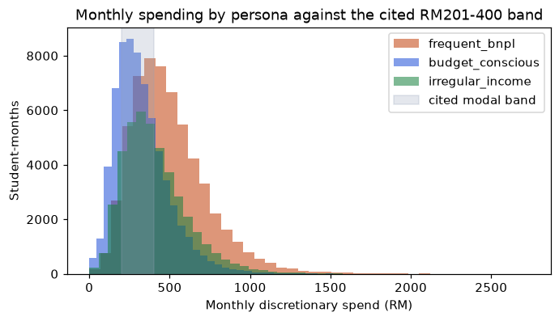
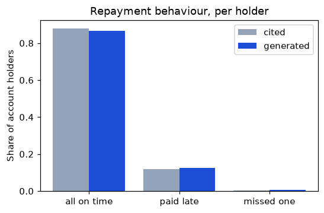
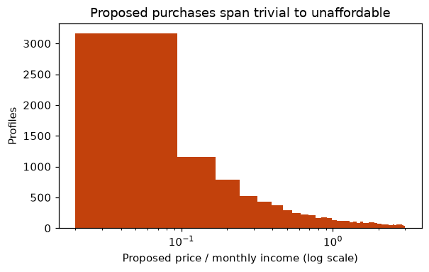
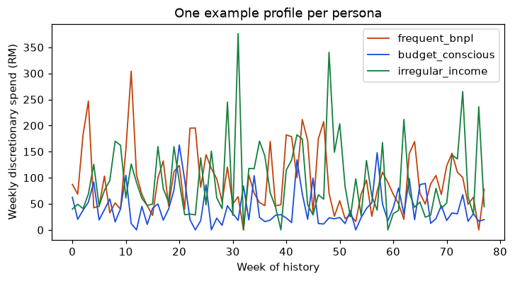

# Synthetic population: distribution report

> Generated by `python -m ml.datagen.report` - do not edit by hand.

Run: seed 20251228, 10000 profiles, parameter hash `041c6ed3495ee064`.

16 of 121 parameters are cited; 105 are assumed.

Every measured moment with a target is within its tolerance.

## Generated moments against their targets

| param | kind | target | measured | unit | status | note |
|---|---|---|---|---|---|---|
| income.ptptn_annual_sen | cited (wiring check) | 1.0000 | 1.0000 | share | within tolerance | 13734 lump sums |
| discretionary.monthly_median_sen.budget_conscious | cited | 30000 | 29682 | sen | within tolerance | target is the midpoint of a modal band (RM201-400), not a bound |
| discretionary.category_weight_food | cited | 0.5190 | 0.5188 | share | within tolerance | food and eating out are one generated category |
| discretionary.category_weight_eating_out | cited |  |  | share | no target | measured jointly with category_weight_food |
| discretionary.category_weight_transport | cited | 0.1810 | 0.1808 | share | within tolerance |  |
| discretionary.other_split_shopping | assumed | 0.1500 | 0.1501 | share | within tolerance |  |
| discretionary.other_split_entertainment | assumed | 0.0900 | 0.0900 | share | within tolerance |  |
| discretionary.other_split_education | assumed | 0.0600 | 0.0603 | share | within tolerance |  |
| derived.food_to_transport_spend_ratio | derived | 2.8673 | 2.8697 | ratio | within tolerance |  |
| bnpl.instalment_options.spaylater | cited (wiring check) | 1.0000 | 1.0000 | share | within tolerance | 5308 plans |
| bnpl.instalment_options.tiktok_paylater | cited (wiring check) | 1.0000 | 1.0000 | share | within tolerance | 2169 plans |
| bnpl.instalment_options.atome | cited (wiring check) | 1.0000 | 1.0000 | share | within tolerance | 2130 plans |
| bnpl.zero_fee_instalments.spaylater | cited (wiring check) | 1.0000 | 1.0000 | share | within tolerance | 5308 plans |
| bnpl.zero_fee_instalments.tiktok_paylater | cited (wiring check) | 1.0000 | 1.0000 | share | within tolerance | 2169 plans |
| bnpl.zero_fee_instalments.atome | cited (wiring check) | 1.0000 | 1.0000 | share | within tolerance | 2130 plans |
| bnpl.long_plan_fee_rate_pct | cited (wiring check) | 1.0000 | 1.0000 | share | within tolerance |  |
| bnpl.limit_cap_sen.spaylater | cited (wiring check) | 1000000 | 1000000 | sen | within tolerance |  |
| bnpl.limit_cap_sen.tiktok_paylater | cited (wiring check) | 1000000 | 881670 | sen | within tolerance |  |
| repayment.on_time_share | cited | 0.8800 | 0.8680 | share | within tolerance | 5151 holders with a settled instalment; the generator adds an assumed miss share |
| repayment.late_but_paid_share | cited | 0.1200 | 0.1266 | share | within tolerance | 5151 holders with a settled instalment; the generator adds an assumed miss share |
| repayment.missed_share | assumed | 0.0040 | 0.0054 | share | within tolerance | 5151 holders with a settled instalment; the generator adds an assumed miss share |
| derived.instalment_on_time_share | derived |  | 0.9315 | share | no target | 55588 instalments |
| population.persona_weights.frequent_bnpl | assumed | 0.3500 | 0.3482 | share | within tolerance |  |
| population.persona_weights.budget_conscious | assumed | 0.4000 | 0.3958 | share | within tolerance |  |
| population.persona_weights.irregular_income | assumed | 0.2500 | 0.2560 | share | within tolerance |  |
| bnpl.ownership_probability.frequent_bnpl | assumed | 0.8500 | 0.8524 | share | within tolerance |  |
| bnpl.ownership_probability.budget_conscious | assumed | 0.2500 | 0.2408 | share | within tolerance |  |
| bnpl.ownership_probability.irregular_income | assumed | 0.5500 | 0.5477 | share | within tolerance |  |
| bnpl.provider_weights.spaylater | assumed | 0.5000 | 0.4977 | share | within tolerance |  |
| bnpl.provider_weights.tiktok_paylater | assumed | 0.2000 | 0.2034 | share | within tolerance |  |
| bnpl.provider_weights.atome | assumed | 0.2000 | 0.1997 | share | within tolerance |  |
| bnpl.provider_weights.other | assumed | 0.1000 | 0.0993 | share | within tolerance |  |
| derived.monthly_income_median.frequent_bnpl | derived |  | 89053 | sen | no target |  |
| derived.monthly_income_median.budget_conscious | derived |  | 53681 | sen | no target |  |
| derived.monthly_income_median.irregular_income | derived |  | 84979 | sen | no target |  |
| purchase.price_to_monthly_income_range | assumed | 3.0000 | 2.9980 | ratio | within tolerance | smallest 0.0200 (range starts at 0.02) |
| derived.purchase_limit_capped_share | derived |  | 0.0638 | share | no target |  |









## Assumed parameters

None of these has a published source; each is a choice, and the reason is stated.

| parameter | value | why |
|---|---|---|
| `population.persona_weights.frequent_bnpl` | 0.35 | No published split of students into BNPL-usage personas. The three personas are the supervisor's UAT groups; weights are chosen so every group has thousands of training profiles. |
| `population.persona_weights.budget_conscious` | 0.4 | As above. |
| `population.persona_weights.irregular_income` | 0.25 | As above. |
| `history.default_months` | 18 | Long enough for rolling-origin evaluation (minimum 26 training weeks plus test windows); the app itself only requires 4 months. |
| `history.persona_months` | 4 | Supervisor-mandated length of the UAT persona histories (academic-constraints.md section 3) - a design constraint, not an empirical figure. |
| `income.ptptn_pay_day` | 10 | Assumed day of the month a PTPTN lump sum lands; the PTPTN page gives no dates. |
| `income.allowance_probability.frequent_bnpl` | 1.0 | Assumed that this persona receives a regular family allowance. |
| `income.allowance_probability.budget_conscious` | 1.0 | Assumed fixed-income persona: regular family allowance. |
| `income.allowance_probability.irregular_income` | 0.3 | Assumed: gig-income persona mostly self-funded, sometimes topped up by family. |
| `income.allowance_median_sen.frequent_bnpl` | 60000 | No published distribution of student allowances. Chosen so that spending in the cited RM201-400 modal band (tok_cheah_2024) plus bills is affordable. |
| `income.allowance_median_sen.budget_conscious` | 50000 | As above, set a little above the cited modal spending band so the persona is solvent but tight. |
| `income.allowance_median_sen.irregular_income` | 20000 | Small occasional top-up only. |
| `income.allowance_sigma` | 0.25 | Log-normal spread of allowance between students; no published figure. |
| `income.allowance_day_of_month` | [1, 5] | Allowances typically arrive at the start of the month; range assumed. |
| `income.ptptn_probability.frequent_bnpl` | 0.45 | PTPTN page gives amounts but not the share of students holding a loan. |
| `income.ptptn_probability.budget_conscious` | 0.55 | As above; assumed higher for the lower-income persona. |
| `income.ptptn_probability.irregular_income` | 0.3 | As above. |
| `income.ptptn_disbursements_per_year` | 2 | The PTPTN page does not state the number or timing of disbursements (an earlier research note said 2-3; the page does not support it). Two per year, at semester starts, is assumed. |
| `income.ptptn_months` | [3, 9] | Assumed semester-start months for the two lump sums. |
| `income.parttime_probability.frequent_bnpl` | 0.5 | No published share of students with part-time work. |
| `income.parttime_probability.budget_conscious` | 0.1 | Fixed-income persona: rarely works. |
| `income.parttime_probability.irregular_income` | 0.0 | This persona's work is modelled as gig income instead. |
| `income.parttime_monthly_median_sen` | 45000 | Assumed part-time monthly pay; no published figure for students. |
| `income.parttime_sigma` | 0.2 | Log-normal spread of part-time pay. |
| `income.parttime_monthly_jitter` | 0.1 | Month-to-month variation in part-time pay (hours differ). |
| `income.parttime_pay_day` | 28 | Month-end pay assumed. |
| `income.gig_jobs_per_week_mean` | 2.5 | Mean jobs per week for the irregular-income persona (Poisson); no published figure. |
| `income.gig_pay_median_sen` | 7000 | Median pay per gig job; no published figure. |
| `income.gig_pay_sigma` | 0.5 | Log-normal spread of gig pay. |
| `income.gig_dry_spell_probability_per_month` | 0.15 | Chance a month has far fewer jobs (exams, holidays); the irregularity this persona exists to test. |
| `income.gig_dry_spell_job_multiplier` | 0.2 | Job volume multiplier during a dry spell. |
| `bills.max_subscriptions` | 2 | Most streaming / cloud subscriptions one profile carries; no published figure. |
| `bills.subscription_day_range` | [1, 28] | Day of month a subscription renews; drawn uniformly, kept to 28 so every month has the day. |
| `bills.rent_probability` | 0.8 | Share of students paying hostel/rent themselves; no official figure. |
| `bills.rent_monthly_sen_range` | [15000, 45000] | Hostel/shared-room range. Only a commercial budgeting site gives figures (hostel-based total RM650-1,080), with no stated method, so it is not cited. |
| `bills.rent_day_of_month` | [1, 5] | Rent due at the start of the month. |
| `bills.phone_monthly_sen_range` | [3000, 6000] | Prepaid/postpaid data plan; typical range assumed. |
| `bills.phone_day_of_month` | [10, 20] | Assumed billing-day range. |
| `bills.subscription_probability` | 0.6 | Share with a streaming/music subscription. |
| `bills.subscription_monthly_sen_range` | [1500, 4000] | Assumed price range per subscription. |
| `bills.variable_bill_jitter_ratio` | 0.03 | Small month-to-month variation in phone/utility bills. |
| `discretionary.min_txn_share_of_typical` | 0.3 | No single purchase is smaller than this fraction of its category's typical size (a RM2 burger meal is not generated). |
| `discretionary.min_txn_sen` | 100 | Smallest discretionary transaction (RM1); smaller amounts are folded into the week's biggest category. |
| `discretionary.weekly_ar1_phi` | 0.5 | Week-to-week persistence of a student's spending level (AR(1) coefficient). No published figure; gives the weekly series temporal structure so benchmarks that ignore it are not unfairly favoured. |
| `discretionary.weekly_ar1_sigma` | 0.12 | Innovation scale of the weekly spending-level drift (log scale); no published figure. |
| `discretionary.payday_week_total_bump_ratio` | 0.1 | Lift in a whole week's spending when an income payment lands in it; no published figure. |
| `discretionary.category_allocation_concentration` | 25 | How tightly a week's spend follows the cited category shares (Dirichlet concentration; higher is tighter). No published figure. |
| `discretionary.category_typical_txn_sen.food` | 1200 | Typical size of one food or eating-out transaction (RM12). No published transaction-level sizes. |
| `discretionary.category_typical_txn_sen.transport` | 600 | Typical transport transaction (RM6). |
| `discretionary.category_typical_txn_sen.shopping` | 6000 | Typical shopping transaction (RM60). |
| `discretionary.category_typical_txn_sen.entertainment` | 4000 | Typical entertainment transaction (RM40). |
| `discretionary.category_typical_txn_sen.education` | 8000 | Typical education transaction (RM80). |
| `discretionary.payday_window_days` | 3 | Days after an income credit in which spending runs higher (see payday_bump_ratio); no published figure. |
| `discretionary.txn_amount_gamma_shape` | 3.0 | Gamma shape of transaction sizes within a week; higher means fewer very small purchases. Chosen so persona CSVs read plausibly to testers. |
| `discretionary.refund_amount_sen_range` | [2000, 15000] | Refund size, drawn uniformly (RM20-150); no published figure. |
| `discretionary.transfer_amount_sen_range` | [2000, 10000] | Own-account top-up size, drawn uniformly (RM20-100); no published figure. |
| `discretionary.monthly_median_sen.frequent_bnpl` | 45000 | tok_cheah_2024 reports spending rises with income but gives no number; set above the modal band. |
| `discretionary.monthly_median_sen.irregular_income` | 35000 | Between the other two personas. |
| `discretionary.student_level_sigma` | 0.3 | Log-normal spread of how much different students of the same persona spend; no published figure. |
| `discretionary.weekly_sigma` | 0.45 | Log-normal week-to-week spread of discretionary spending; no published figure. |
| `discretionary.day_of_week_weights` | [0.9, 0.9, 0.95, 1.0, 1.25, 1.3, 0.9] | Monday..Sunday spending shape (weekend peak); no published figure. Deliberately not present in Engine 1's model so the cohort is richer than the forecaster. |
| `discretionary.payday_bump_ratio` | 0.25 | Extra spending in the three days after income lands. |
| `discretionary.exam_week_dip_ratio` | 0.3 | Spending falls during exam weeks. |
| `discretionary.exam_months` | [6, 12] | Assumed end-of-semester exam months; the app is used across institutions with different calendars. |
| `discretionary.exam_weeks_per_semester` | 2 | Assumed length of exam periods. |
| `discretionary.outlier_probability_per_week` | 0.04 | Occasional unusually large week (event, trip, repair). |
| `discretionary.outlier_multiplier` | 2.5 | Size of such a week relative to normal. |
| `discretionary.category_other_share` | 0.3 | Share of discretionary spend outside food, eating out and transport (shopping, entertainment, education). The DOSM page gave no shares for these groups. |
| `discretionary.other_split_shopping` | 0.5 | Split of the 'other' discretionary share into shopping / entertainment / education; the DOSM page gave no shares for these groups. |
| `discretionary.other_split_entertainment` | 0.3 | As above. |
| `discretionary.other_split_education` | 0.2 | As above. |
| `discretionary.unrecognisable_description_share` | 0.08 | Share of merchant descriptions the keyword categoriser cannot place (the importer's real-world miss rate is unknown). |
| `discretionary.refund_probability_per_month` | 0.15 | Chance of a refund in a month, so the reserved Refund category is exercised. |
| `discretionary.transfer_probability_per_month` | 0.4 | Chance of an own-account move (e-wallet top-up), so the reserved Transfer category is exercised. |
| `bnpl.limit_floor_sen` | 1000 | Smallest limit a provider grants (RM10). |
| `bnpl.history_lookback_days` | 60 | Existing plans may have started up to this many days before the visible history, so early instalments fall inside it. |
| `bnpl.first_payment_slack_days` | 3 | A manually typed first payment date is rarely exactly one month after purchase; up to this many days later. |
| `bnpl.ownership_probability.frequent_bnpl` | 0.85 | Defines the persona. No published share of students using BNPL (bnpl_billing_rules_my and bnm_fsr_2h2022 describe users, not students). |
| `bnpl.ownership_probability.budget_conscious` | 0.25 | Defines the persona (uses BNPL rarely). |
| `bnpl.ownership_probability.irregular_income` | 0.55 | Defines the persona. |
| `bnpl.active_plans_extra_mean.frequent_bnpl` | 1.4 | Mean extra concurrent plans beyond the first, given ownership (Poisson); stacking is common abroad (CFPB) but there is no Malaysian student figure. |
| `bnpl.active_plans_extra_mean.budget_conscious` | 0.3 | As above. |
| `bnpl.active_plans_extra_mean.irregular_income` | 0.7 | As above. |
| `bnpl.provider_weights.spaylater` | 0.5 | No published student market shares; SPayLater assumed most common (Shopee reach). |
| `bnpl.provider_weights.tiktok_paylater` | 0.2 | As above. |
| `bnpl.provider_weights.atome` | 0.2 | As above. |
| `bnpl.provider_weights.other` | 0.1 | Other providers use the manual entry path (D-24). |
| `bnpl.price_median_sen` | 15000 | Median BNPL purchase price; no published figure. |
| `bnpl.price_sigma` | 0.9 | Log-normal spread of purchase prices. |
| `bnpl.price_range_sen` | [1500, 150000] | Clamp on existing-plan prices. |
| `bnpl.instalment_options.other` | [2, 3, 4, 6, 12] | Manual-entry providers: plausible plan lengths; the user types what their checkout shows. |
| `bnpl.zero_fee_instalments.other` | [2, 3] | Manual-entry providers: short plans assumed fee-free, longer ones at the long-plan rate. |
| `bnpl.limit_cap_sen.atome` | 500000 | The document says only that Atome limits 'vary by user'. |
| `bnpl.limit_median_sen.spaylater` | 150000 | The documented RM2,500-10,000 range is for the general user base; students (new accounts, temporary limits) are assumed lower. |
| `bnpl.limit_median_sen.tiktok_paylater` | 100000 | As above (documented: up to RM10,000, starts smaller). |
| `bnpl.limit_median_sen.atome` | 80000 | Documented: new users get lower limits. |
| `bnpl.limit_sigma` | 0.6 | Log-normal spread of limits. |
| `bnpl.limit_known_probability` | 0.8 | Share of users who record their limit in the app (the limit_known feature). |
| `repayment.late_payer_late_instalment_share` | 0.5 | Among students who pay late at all, the share of their instalments that are late (at least one always is). The cited study reports holders, not instalments. |
| `repayment.missed_share` | 0.004 | The source says 'fewer than 0.5%' could not repay; 0.4% is chosen within that bound. The three shares are renormalised by the generator. |
| `repayment.late_days_range` | [1, 14] | How late a late payment is; no published distribution. |
| `purchase.income_floor_sen` | 10000 | RM100: a student with no visible income still gets a priced purchase. |
| `purchase.price_floor_sen` | 1000 | Smallest proposed price (RM10). |
| `purchase.price_cap_sen` | 5000000 | Largest proposed price (RM50,000). |
| `purchase.price_to_monthly_income_range` | [0.02, 3.0] | Proposed-purchase price as a multiple of expected monthly income, sampled log-uniformly so Engine 2 sees clearly safe, borderline and clearly unaffordable cases. Chosen for coverage, not realism. |

## Limitations

- **There are no real students here.** Every profile is synthetic, so every result trained or
  evaluated on it describes the generator as much as it describes the models.
- **The data is partly circular by construction.** The generator and the forecasters are written
  by the same author. To limit this, the weekly series carries structure the forecasters are not
  told about (AR(1) drift in the spending level, a payday-week lift, exam-week dips, occasional
  very large weeks; day-of-week effects only reshuffle spending inside a week and do not reach the
  weekly series), but a forecaster that happens to match those effects will look better than it
  would on real data. Real-data benchmarks (Berka, if obtainable) are used only as
  a sanity check, never as the headline result.
- **Most parameters are assumptions.** Published figures about Malaysian student finances are
  scarce, so the majority of parameters are assumed; the cited ones are listed with their source in
  `tables/parameters.csv`. Assumed values are chosen to be plausible and to span the range the
  models must handle, then stress-tested rather than defended.
- **The spending band is an interpretation.** The cited study reports that many students spend
  RM201-400 a month, most naturally their total spending. The generator applies it to
  *discretionary* spending only and adds rent, phone and subscriptions on top, so total
  spending is higher than the band. This is a modelling choice, not something the source says.
- **Provider rules are simplified.** SPayLater's 6-month plan (fee disputed in the billing-rules
  note) is left out, and the 3-month 0% plan, which applies to Shopee marketplace checkouts, is
  modelled as available on every SPayLater purchase.
- **Many "cited" rows are wiring checks.** Rows marked `cited (wiring check)` hold by construction
  (an instalment count drawn from the provider's own list is in that list). They show the cited
  rules were applied, not that the population matches reality. The distribution comparisons are the
  spend level, the category shares and the per-holder repayment shares.
- **Cited targets are checked, not proven.** A generated moment landing near its target shows the
  generator is wired correctly; it does not show the population is realistic. The cited repayment
  figures describe account holders (not instalments) and are compared per holder.
- **Reproducibility is verified on one software stack.** Regeneration is byte-identical on the
  machine and package versions recorded in `data/synthetic/MANIFEST.json`. A different numpy
  version or CPU could change a transaction by a sen (exp/log are CPU-dispatched), and a different
  matplotlib build changes figure bytes; the tables are the record, the figures are illustrations.
- **Labels are simulated.** Engine 2's label is Engine 1's simulated shortfall probability, so the
  risk model inherits whatever the forecaster and the simulation get wrong.

## Regenerate

```
cd backend
uv run python -m ml.datagen.report
```
