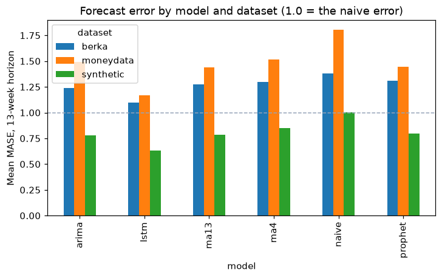
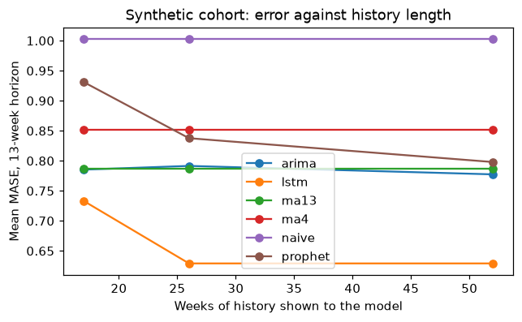

# Engine 1 evaluation: which forecaster to serve

> Generated by `python -m ml.engine1_eval.report` - do not edit by hand.

Run `full`, seed 20251228, horizon 13 weeks, candidates naive, ma4, ma13, arima, prophet, lstm.

Datasets in this run: berka, moneydata, synthetic. Model failures recorded: 0 (`failures.csv` in the run directory).

## Decision

Rule (ADR D-06): serve the best literature candidate (ARIMA, Prophet, LSTM) by MASE at 13 weeks, unless the best benchmark beats it by at least 0.02 MASE with a Holm-adjusted Wilcoxon p < 0.05, in which case the benchmark is served and that is the finding. "MASE" here is the geometric mean over a dataset's series (so one series with a nearly flat history cannot decide the ranking), then the mean over datasets with equal weight; the plain arithmetic mean is shown beside it. Only series every model scored are used; the synthetic cohort is scored at the longest history shown to the models, and the rule is also applied at each shorter history (table below).

**Served model: `lstm`** (rule branch: literature). Best literature candidate `lstm` (metric 0.8153); best benchmark `ma13` (metric 1.0438). Median per-series MASE difference (literature minus benchmark) -0.1095, 95% CI [-0.1504, -0.0779], Holm-adjusted Wilcoxon p = 2.363e-37 over 242 series (0 dropped because some model failed on them).

| model | decision_metric (geometric) | arithmetic mean |
|---|---|---|
| arima | 1.046 | 1.291 |
| lstm | 0.8153 | 1.084 |
| ma13 | 1.0438 | 1.2871 |
| ma4 | 1.0947 | 1.3423 |
| naive | 1.2581 | 1.5224 |
| prophet | 1.0619 | 1.3082 |

On 13-week cumulative-margin error (mean over datasets) the served model `lstm` ranks 1 of 6 (3.582 against 3.582 for `lstm`).



### The same rule at each history length

| history_weeks | best_literature | best_benchmark | served | branch | median_difference | p_holm |
|---|---|---|---|---|---|---|
| 17 | lstm | ma13 | lstm | literature | -0.0758 | 0.0 |
| 26 | lstm | ma13 | lstm | literature | -0.1095 | 0.0 |
| 52 | lstm | ma13 | lstm | literature | -0.1095 | 0.0 |

### Best model per dataset

| source | best_model | best_literature |
|---|---|---|
| berka | lstm | lstm |
| moneydata | lstm | lstm |
| synthetic | lstm | lstm |

## Against the best benchmark

| model | against | series | median_mase_difference | ci_low | ci_high | p_value | p_holm |
|---|---|---|---|---|---|---|---|
| arima | ma13 | 242 | -0.0186 | -0.0251 | -0.0118 | 0.0 | 0.0 |
| lstm | ma13 | 242 | -0.1095 | -0.1504 | -0.0779 | 0.0 | 0.0 |
| ma4 | ma13 | 242 | 0.0257 | 0.0122 | 0.0384 | 0.0 | 0.0 |
| naive | ma13 | 242 | 0.1455 | 0.1066 | 0.1801 | 0.0 | 0.0 |
| prophet | ma13 | 242 | 0.0075 | 0.0033 | 0.013 | 0.0 | 0.0 |

### Diebold-Mariano (HLN), per series, best literature model vs best benchmark

| source | literature | benchmark | series_tested | share_literature_better | share_significant_either_way | overlapping_origins |
|---|---|---|---|---|---|---|
| berka | lstm | ma13 | 120 | 0.725 | 0.725 | 2 |
| moneydata | lstm | ma13 | 2 | 1.0 | 1.0 | 4 |
| synthetic | lstm | ma13 | 120 | 0.075 | 0.075 | 13 |

## Friedman and Nemenyi (lower rank is better)

| source | kind | series | friedman_p | critical_difference | mean_ranks | significant_pairs |
|---|---|---|---|---|---|---|
| berka | income | 60 | 0.0 | 0.9735 | arima=2.78; lstm=1.10; ma13=3.98; ma4=4.18; naive=4.97; prophet=3.98 | arima<>lstm; arima<>ma13; arima<>ma4; arima<>naive; arima<>prophet; lstm<>ma13; lstm<>ma4; lstm<>naive; lstm<>prophet; ma13<>naive; naive<>prophet |
| berka | spend | 60 | 0.0 | 0.9735 | arima=2.95; lstm=1.35; ma13=3.25; ma4=3.87; naive=4.92; prophet=4.67 | arima<>lstm; arima<>naive; arima<>prophet; lstm<>ma13; lstm<>ma4; lstm<>naive; lstm<>prophet; ma13<>naive; ma13<>prophet; ma4<>naive |
| synthetic | income | 60 | 0.0 | 0.9735 | arima=2.88; lstm=1.10; ma13=3.20; ma4=5.02; naive=5.30; prophet=3.50 | arima<>lstm; arima<>ma4; arima<>naive; lstm<>ma13; lstm<>ma4; lstm<>naive; lstm<>prophet; ma13<>ma4; ma13<>naive; ma4<>prophet; naive<>prophet |
| synthetic | spend | 60 | 0.0 | 0.9735 | arima=2.48; lstm=1.93; ma13=3.05; ma4=4.22; naive=5.85; prophet=3.47 | arima<>ma4; arima<>naive; arima<>prophet; lstm<>ma13; lstm<>ma4; lstm<>naive; lstm<>prophet; ma13<>ma4; ma13<>naive; ma4<>naive; naive<>prophet |

## Error by dataset, kind and model

| source | history_limit | kind | model | mase_1 | mase_4 | mase_13 | median_mase | series | origins |
|---|---|---|---|---|---|---|---|---|---|
| berka |  | income | arima | 0.6442 | 0.7285 | 0.7864 | 0.6996 | 60 | 1203 |
| berka |  | income | lstm | 0.4671 | 0.5247 | 0.5675 | 0.4262 | 60 | 1203 |
| berka |  | income | ma13 | 0.8288 | 0.8314 | 0.8447 | 0.7683 | 60 | 1203 |
| berka |  | income | ma4 | 0.8855 | 0.8486 | 0.8614 | 0.7885 | 60 | 1203 |
| berka |  | income | naive | 1.0215 | 0.9188 | 0.8963 | 0.5369 | 60 | 1203 |
| berka |  | income | prophet | 0.8448 | 0.8406 | 0.8461 | 0.7705 | 60 | 1203 |
| berka |  | spend | arima | 1.0485 | 1.3174 | 1.6916 | 0.7852 | 60 | 1203 |
| berka |  | spend | lstm | 0.9793 | 1.2609 | 1.6249 | 0.7596 | 60 | 1203 |
| berka |  | spend | ma13 | 1.0744 | 1.3451 | 1.7064 | 0.8468 | 60 | 1203 |
| berka |  | spend | ma4 | 1.1171 | 1.3629 | 1.7391 | 0.8396 | 60 | 1203 |
| berka |  | spend | naive | 1.3177 | 1.5005 | 1.8645 | 0.7558 | 60 | 1203 |
| berka |  | spend | prophet | 1.1246 | 1.3935 | 1.776 | 0.8944 | 60 | 1203 |
| moneydata |  | income | arima | 0.849 | 1.4461 | 1.5404 | 0.8641 | 1 | 94 |
| moneydata |  | income | lstm | 0.5729 | 0.9848 | 0.9948 | 0.6059 | 1 | 94 |
| moneydata |  | income | ma13 | 0.9994 | 1.3581 | 1.3259 | 0.9131 | 1 | 94 |
| moneydata |  | income | ma4 | 1.1217 | 1.4134 | 1.3786 | 0.9135 | 1 | 94 |
| moneydata |  | income | naive | 1.3176 | 1.6159 | 1.4742 | 0.9093 | 1 | 94 |
| moneydata |  | income | prophet | 1.0538 | 1.4222 | 1.3979 | 1.0216 | 1 | 94 |
| moneydata |  | spend | arima | 0.8629 | 1.4589 | 1.4497 | 0.971 | 1 | 94 |
| moneydata |  | spend | lstm | 0.7364 | 1.3812 | 1.3441 | 0.9515 | 1 | 94 |
| moneydata |  | spend | ma13 | 1.0468 | 1.5467 | 1.5473 | 1.0353 | 1 | 94 |
| moneydata |  | spend | ma4 | 1.1429 | 1.6457 | 1.6495 | 0.9767 | 1 | 94 |
| moneydata |  | spend | naive | 1.5099 | 2.1933 | 2.1388 | 1.0322 | 1 | 94 |
| moneydata |  | spend | prophet | 1.1475 | 1.5205 | 1.4983 | 1.135 | 1 | 94 |
| synthetic | 17 | income | arima | 0.7901 | 0.8175 | 0.81 | 0.8128 | 60 | 840 |
| synthetic | 17 | income | lstm | 0.8338 | 0.7938 | 0.7603 | 0.7693 | 60 | 840 |
| synthetic | 17 | income | ma13 | 0.8979 | 0.8647 | 0.8357 | 0.8357 | 60 | 840 |
| synthetic | 17 | income | ma4 | 1.0034 | 0.9466 | 0.9145 | 0.8627 | 60 | 840 |
| synthetic | 17 | income | naive | 1.162 | 1.0969 | 1.0303 | 0.803 | 60 | 840 |
| synthetic | 17 | income | prophet | 1.0003 | 0.9256 | 0.9427 | 0.8666 | 60 | 840 |
| synthetic | 17 | spend | arima | 0.784 | 0.759 | 0.7606 | 0.7117 | 60 | 840 |
| synthetic | 17 | spend | lstm | 0.7109 | 0.7069 | 0.7057 | 0.6696 | 60 | 840 |
| synthetic | 17 | spend | ma13 | 0.7361 | 0.7311 | 0.7376 | 0.7102 | 60 | 840 |
| synthetic | 17 | spend | ma4 | 0.803 | 0.7907 | 0.7878 | 0.7472 | 60 | 840 |
| synthetic | 17 | spend | naive | 0.9857 | 0.9839 | 0.9765 | 0.8463 | 60 | 840 |
| synthetic | 17 | spend | prophet | 0.7966 | 0.8166 | 0.9191 | 0.865 | 60 | 840 |
| synthetic | 26 | income | arima | 0.7987 | 0.851 | 0.8402 | 0.8331 | 60 | 840 |
| synthetic | 26 | income | lstm | 0.4982 | 0.5651 | 0.5568 | 0.5521 | 60 | 840 |
| synthetic | 26 | income | ma13 | 0.8979 | 0.8647 | 0.8357 | 0.8357 | 60 | 840 |
| synthetic | 26 | income | ma4 | 1.0034 | 0.9466 | 0.9145 | 0.8627 | 60 | 840 |
| synthetic | 26 | income | naive | 1.162 | 1.0969 | 1.0303 | 0.803 | 60 | 840 |
| synthetic | 26 | income | prophet | 0.9711 | 0.8893 | 0.8592 | 0.8276 | 60 | 840 |
| synthetic | 26 | spend | arima | 0.7431 | 0.7338 | 0.7427 | 0.7054 | 60 | 840 |
| synthetic | 26 | spend | lstm | 0.7044 | 0.7024 | 0.7015 | 0.659 | 60 | 840 |
| synthetic | 26 | spend | ma13 | 0.7361 | 0.7311 | 0.7376 | 0.7102 | 60 | 840 |
| synthetic | 26 | spend | ma4 | 0.803 | 0.7907 | 0.7878 | 0.7472 | 60 | 840 |
| synthetic | 26 | spend | naive | 0.9857 | 0.9839 | 0.9765 | 0.8463 | 60 | 840 |
| synthetic | 26 | spend | prophet | 0.7718 | 0.7759 | 0.816 | 0.7796 | 60 | 840 |
| synthetic | 52 | income | arima | 0.7856 | 0.8387 | 0.8241 | 0.8183 | 60 | 840 |
| synthetic | 52 | income | lstm | 0.4982 | 0.5651 | 0.5568 | 0.5521 | 60 | 840 |
| synthetic | 52 | income | ma13 | 0.8979 | 0.8647 | 0.8357 | 0.8357 | 60 | 840 |
| synthetic | 52 | income | ma4 | 1.0034 | 0.9466 | 0.9145 | 0.8627 | 60 | 840 |
| synthetic | 52 | income | naive | 1.162 | 1.0969 | 1.0303 | 0.803 | 60 | 840 |
| synthetic | 52 | income | prophet | 0.9365 | 0.8829 | 0.8456 | 0.8386 | 60 | 840 |
| synthetic | 52 | spend | arima | 0.7406 | 0.7268 | 0.7307 | 0.6973 | 60 | 840 |
| synthetic | 52 | spend | lstm | 0.7044 | 0.7024 | 0.7015 | 0.659 | 60 | 840 |
| synthetic | 52 | spend | ma13 | 0.7361 | 0.7311 | 0.7376 | 0.7102 | 60 | 840 |
| synthetic | 52 | spend | ma4 | 0.803 | 0.7907 | 0.7878 | 0.7472 | 60 | 840 |
| synthetic | 52 | spend | naive | 0.9857 | 0.9839 | 0.9765 | 0.8463 | 60 | 840 |
| synthetic | 52 | spend | prophet | 0.7391 | 0.7373 | 0.7503 | 0.724 | 60 | 840 |



## Bias (mean forecast minus actual, in naive-error units; above 0 = over-forecast)

| source | kind | model | mean_bias_mase_units |
|---|---|---|---|
| berka | income | arima | -0.0152 |
| berka | income | lstm | -0.117 |
| berka | income | ma13 | -0.0341 |
| berka | income | ma4 | -0.0258 |
| berka | income | naive | -0.0414 |
| berka | income | prophet | -0.0536 |
| berka | spend | arima | -0.7833 |
| berka | spend | lstm | -0.9373 |
| berka | spend | ma13 | -0.7831 |
| berka | spend | ma4 | -0.7701 |
| berka | spend | naive | -0.7203 |
| berka | spend | prophet | -0.6369 |
| moneydata | income | arima | 0.0983 |
| moneydata | income | lstm | -0.4018 |
| moneydata | income | ma13 | -0.2182 |
| moneydata | income | ma4 | -0.1805 |
| moneydata | income | naive | -0.2195 |
| moneydata | income | prophet | -0.0401 |
| moneydata | spend | arima | -0.1748 |
| moneydata | spend | lstm | -0.3925 |
| moneydata | spend | ma13 | -0.1008 |
| moneydata | spend | ma4 | -0.0665 |
| moneydata | spend | naive | 0.0993 |
| moneydata | spend | prophet | 0.0129 |
| synthetic | income | arima | -0.0345 |
| synthetic | income | lstm | -0.1698 |
| synthetic | income | ma13 | -0.1078 |
| synthetic | income | ma4 | -0.0163 |
| synthetic | income | naive | 0.0283 |
| synthetic | income | prophet | -0.095 |
| synthetic | spend | arima | -0.0163 |
| synthetic | spend | lstm | -0.2718 |
| synthetic | spend | ma13 | -0.0383 |
| synthetic | spend | ma4 | -0.0302 |
| synthetic | spend | naive | -0.0201 |
| synthetic | spend | prophet | -0.0646 |

## Cumulative-margin error (scaled)

| source | model | margin_1 | margin_4 | margin_13 |
|---|---|---|---|---|
| berka | arima | 0.6021 | 1.1307 | 1.9783 |
| berka | lstm | 0.5466 | 1.1267 | 1.895 |
| berka | ma13 | 0.6627 | 1.2178 | 2.2907 |
| berka | ma4 | 0.7584 | 1.5736 | 3.9214 |
| berka | naive | 1.0485 | 3.0732 | 8.6005 |
| berka | prophet | 0.6865 | 1.2457 | 2.3382 |
| moneydata | arima | 0.6873 | 3.4971 | 9.5866 |
| moneydata | lstm | 0.5567 | 2.6915 | 5.9541 |
| moneydata | ma13 | 0.7287 | 3.0512 | 7.3804 |
| moneydata | ma4 | 0.9739 | 3.7565 | 9.3934 |
| moneydata | naive | 1.4871 | 5.9938 | 15.8771 |
| moneydata | prophet | 0.7601 | 2.5342 | 5.919 |
| synthetic | arima | 0.7566 | 1.4747 | 2.1254 |
| synthetic | lstm | 0.5458 | 1.4263 | 2.8982 |
| synthetic | ma13 | 0.837 | 1.531 | 3.5945 |
| synthetic | ma4 | 0.9354 | 2.0792 | 5.4217 |
| synthetic | naive | 1.1372 | 3.7244 | 10.8205 |
| synthetic | prophet | 0.8719 | 1.667 | 3.9835 |

## Interval coverage

| source | model | coverage | width | share_with_interval |
|---|---|---|---|---|
| berka | arima | 0.7184 | 1.7603 | 0.5511 |
| berka | lstm | 0.7309 | 1.5322 | 0.5511 |
| berka | ma13 | 0.7406 | 1.8387 | 0.5511 |
| berka | ma4 | 0.7457 | 1.8261 | 0.5511 |
| berka | naive | 0.7678 | 1.7618 | 0.5511 |
| berka | prophet | 0.6878 | 1.8049 | 0.5511 |
| moneydata | arima | 0.5987 | 2.1748 | 0.883 |
| moneydata | lstm | 0.6409 | 1.8833 | 0.883 |
| moneydata | ma13 | 0.6344 | 2.2376 | 0.883 |
| moneydata | ma4 | 0.684 | 2.2797 | 0.883 |
| moneydata | naive | 0.6506 | 2.3042 | 0.883 |
| moneydata | prophet | 0.6237 | 2.2306 | 0.883 |
| synthetic | arima |  |  | 0.0 |
| synthetic | lstm |  |  | 0.0 |
| synthetic | ma13 |  |  | 0.0 |
| synthetic | ma4 |  |  | 0.0 |
| synthetic | naive |  |  | 0.0 |
| synthetic | prophet |  |  | 0.0 |


## Cost

| source | history_limit | model | seconds | origins | ms_per_origin |
|---|---|---|---|---|---|
| berka |  | arima | 1239.401 | 2406 | 515.1293 |
| berka |  | lstm | 2.695 | 2406 | 1.1201 |
| berka |  | ma13 | 0.046 | 2406 | 0.0191 |
| berka |  | ma4 | 0.047 | 2406 | 0.0195 |
| berka |  | naive | 0.032 | 2406 | 0.0133 |
| berka |  | prophet | 610.291 | 2406 | 253.6538 |
| moneydata |  | arima | 113.845 | 188 | 605.5585 |
| moneydata |  | lstm | 0.105 | 188 | 0.5585 |
| moneydata |  | ma13 | 0.004 | 188 | 0.0213 |
| moneydata |  | ma4 | 0.003 | 188 | 0.016 |
| moneydata |  | naive | 0.002 | 188 | 0.0106 |
| moneydata |  | prophet | 46.371 | 188 | 246.6543 |
| synthetic | 17 | arima | 616.387 | 1680 | 366.897 |
| synthetic | 17 | lstm | 1.517 | 1680 | 0.903 |
| synthetic | 17 | ma13 | 0.035 | 1680 | 0.0208 |
| synthetic | 17 | ma4 | 0.036 | 1680 | 0.0214 |
| synthetic | 17 | naive | 0.024 | 1680 | 0.0143 |
| synthetic | 17 | prophet | 400.015 | 1680 | 238.1042 |
| synthetic | 26 | arima | 528.624 | 1680 | 314.6571 |
| synthetic | 26 | lstm | 1.732 | 1680 | 1.031 |
| synthetic | 26 | ma13 | 0.036 | 1680 | 0.0214 |
| synthetic | 26 | ma4 | 0.036 | 1680 | 0.0214 |
| synthetic | 26 | naive | 0.025 | 1680 | 0.0149 |
| synthetic | 26 | prophet | 430.87 | 1680 | 256.4702 |
| synthetic | 52 | arima | 584.677 | 1680 | 348.022 |
| synthetic | 52 | lstm | 1.902 | 1680 | 1.1321 |
| synthetic | 52 | ma13 | 0.034 | 1680 | 0.0202 |
| synthetic | 52 | ma4 | 0.035 | 1680 | 0.0208 |
| synthetic | 52 | naive | 0.023 | 1680 | 0.0137 |
| synthetic | 52 | prophet | 524.196 | 1680 | 312.0214 |

## Read this before trusting any number

- **MASE rewards forecasting the median; the product needs the running total.** Weekly MASE is an
  absolute error, so a model that forecasts the typical week scores well even when that week is
  zero (monthly allowances make more than half of synthetic income weeks zero). The cumulative
  margin table and the bias table show what that costs on the quantity Engine 2's label depends
  on. D-06 fixes MASE as the primary metric, so the rule uses it; the margin and bias results are
  reported beside the decision, never hidden, and the P4 residual bootstrap (which resamples the
  served model's own signed errors) is what must correct any systematic level bias.
- **The synthetic cohort is circular by construction.** The generator and these forecasters have
  the same author. The weekly series carries AR(1) drift, a payday-week lift, exam-week dips and
  outlier weeks (see `reports/datagen/README.md`); a model that happens to match them gains over
  a real series. MoneyData and Berka are reported separately and each counts as much as the whole
  synthetic cohort in the decision, so a single noisy real account (MoneyData has two series)
  carries a third of the metric. The per-dataset table shows whether the datasets agree.
- **All synthetic test series share one calendar** and the cohort has 78 weeks, so every test
  origin falls in the same half-year after the LSTM's cutoff week. Series are correlated through
  that shared calendar, which makes significance tests over them look stronger than they are.
- **Real data is not Malaysian students.** MoneyData is one UK adult's account; its weekly spend
  averages about GBP 1,170, so it probably includes movements between the owner's own accounts, and
  its spend includes fixed bills (no fixed/variable code). Berka is Czech bank accounts from
  1993-1998 with fixed payments removed by its own codes. Both are benchmarks only (D-25).
- **The global LSTM is trained on synthetic data only**, on weeks before the cutoff, with a fixed
  26-week input window (shorter histories are padded with their mean, which it never saw in
  training), and applied zero-shot to MoneyData and Berka. Pre-training it on Berka (D-25) was
  not done in this run.
- **Prediction intervals** are per-step empirical quantiles of the model's own earlier errors, the
  same for every model, and exist only once eight earlier errors for that step are observed. The
  product's 4-week moving-block bootstrap, which simulates whole paths, is built in P4.
- **No synthetic series has interval coverage.** The cohort is 78 weeks long and its test origins
  start at the LSTM's cutoff, so each series has only 13 origins and no origin ever has eight
  earlier errors for a 13-week step. Coverage evidence comes from MoneyData and Berka only (about
  0.6-0.75 against a nominal 0.8) and from the serving check in P4.
- **Income is evaluated as total weekly income.** Splitting it into confirmed and unconfirmed parts
  waits for recurring detection (P4).
- **Errors are scaled by the naive error of the whole history to date**, whatever history the model
  is shown, so the history-length figure compares models against the same yardstick.
- **Evaluated series are a seeded sample**, the same for every model, because Prophet and AutoARIMA
  are refitted at every origin. A series that any model failed on is dropped for all models before
  anything is averaged, and the count is printed above.
- **Windows and settings are fixed, not tuned on test origins:** moving averages of 4 and 13 weeks,
  AutoARIMA with season length 1, Prophet with yearly seasonality only above two years of history.

## Regenerate

```
cd backend
uv run python -m ml.engine1_eval.run --config full
uv run python -m ml.engine1_eval.report --config full
```
