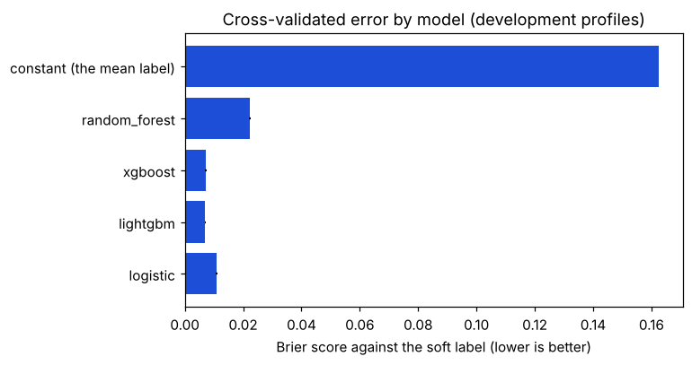
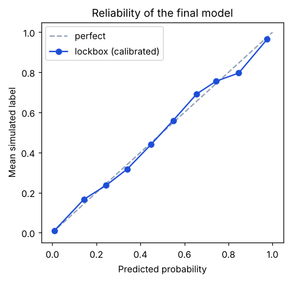
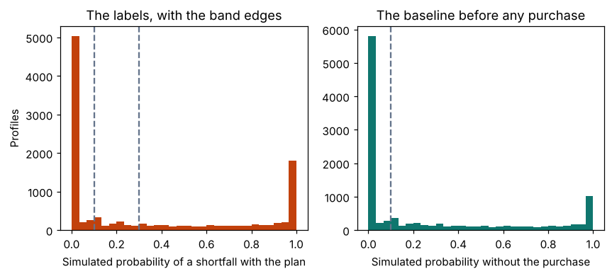

# Engine 2 training: BNPL risk classification

> Generated by `python -m ml.engine2_train.report` - do not edit by hand.

Run `full`: 10000 labelled profiles (9000 development, 1000 lockbox), 5x5 grouped stratified CV, 12 Optuna trials per model per fold, seed 20251228, feature schema `2066b37e13182a5e`, commit `911d0934a7ef981a5f3c872d70ed4243dba8b784+dirty`, labels sha256 `7c8d408db49779b1`.

## Decision

**Winner: `lightgbm`** (lowest mean Brier score); calibration: `platt`. Cross-validated Brier 0.0163 against 0.1799 for always predicting the mean label; on the untouched lockbox 0.0198 against 0.1788. Removing the 6 Engine 1 features changes the cross-validated Brier by +0.0996 (95% CI +0.0957 to +0.1035, corrected p = 2.37e-26): the forecast adds measurable skill. Where the plan decides the band (baseline under 0.10) the change is +0.0903 (95% CI +0.0850 to +0.0956).

| model | brier | brier_se | brier_low_baseline | log_loss | auc_at_030 | calibration_slope | ece | versus_winner_delta | versus_winner_p_unadjusted |
|---|---|---|---|---|---|---|---|---|---|
| logistic | 0.0205 | 0.0002 | 0.0164 | 0.2908 | 0.9849 | 0.9986 | 0.0317 | 0.0042 | 0.0 |
| lightgbm | 0.0163 | 0.0002 | 0.0117 | 0.2638 | 0.9891 | 0.9396 | 0.012 |  |  |
| xgboost | 0.0164 | 0.0002 | 0.0124 | 0.264 | 0.989 | 0.9919 | 0.0093 | 0.0001 | 0.7044 |
| random_forest | 0.0612 | 0.0004 | 0.0723 | 0.4134 | 0.9726 | 2.4394 | 0.126 | 0.0449 | 0.0 |
| constant (the mean label) | 0.1799 |  |  |  |  |  |  |  |  |

Standard errors are naive (fold scores treated as independent); `versus_winner_p_unadjusted` is the corrected resampled t-test against the winner, not adjusted for the number of comparisons.



## The final model on the lockbox

The 1000 lockbox profiles (every tenth) were excluded from cross-validation, model choice, tuning, calibration and the ablation; the final calibrated model was scored on them once. Brier 0.0198, log-loss 0.2788, calibration slope 0.956, ECE 0.0181; the model puts 91.5% of them in the same pre-registered band as the label. According to the append-only log beside the run directories, the lockbox has been scored 1 time (counted from the log's first line; a scoring made before the log existed would not be in it).

| model | brier_all | brier_low_baseline |
|---|---|---|
| lightgbm (calibrated: platt) | 0.0198 | 0.0121 |
| lightgbm (uncalibrated) | 0.0201 | 0.012 |
| logistic (benchmark) | 0.0263 | 0.0198 |
| constant (development mean label; the subgroup's own mean there) | 0.1788 | 0.083 |

**Where the plan decides the band.** The subgroup whose baseline (no purchase) is under 0.10 is scored in full below, beside its own constant benchmark (the subgroup's development mean label, not the overall one). Its labels are dominated by profiles whose label is exactly 0, which any model gets nearly right, so its Brier, ECE, calibration slope and band agreement look better than the subgroup deserves; the breakdown by label class shows how much of every score is those trivial profiles. On the lockbox 33.7% of labels are exactly 0 and 21.0% exactly 1. The breakdown is descriptive: nothing was chosen or tuned on it.

| subgroup | model | profiles | brier | ece | calibration_slope | auc_at_030 | band_agreement |
|---|---|---|---|---|---|---|---|
| low_baseline | lightgbm (calibrated) | 481 | 0.0121 | 0.017 | 1.0145 | 0.9898 | 0.9023 |
| low_baseline | lightgbm (uncalibrated) | 481 | 0.012 | 0.0156 | 0.9547 | 0.9898 |  |
| low_baseline | logistic (benchmark) | 481 | 0.0198 |  |  |  |  |
| low_baseline | constant (0.1149, the subgroup's development mean) | 481 | 0.083 |  |  |  |  |

**Brier by label class** (lockbox, descriptive).

| lockbox profiles | profiles | share_of_lockbox | brier_calibrated | brier_uncalibrated | brier_logistic | brier_constant | share_of_squared_error |
|---|---|---|---|---|---|---|---|
| label strictly between 0 and 1 | 453 | 0.453 | 0.0259 | 0.0269 | 0.0299 | 0.1058 | 0.5914 |
| label exactly 0 | 337 | 0.337 | 0.0058 | 0.0055 | 0.011 | 0.1907 | 0.0985 |
| label exactly 1 | 210 | 0.21 | 0.0293 | 0.0289 | 0.0429 | 0.3173 | 0.3102 |
| baseline strictly between 0 and 1 (0 < p_without < 1) | 468 | 0.468 | 0.0248 | 0.0257 | 0.03 | 0.1349 | 0.5851 |
| baseline exactly 0 or exactly 1 | 532 | 0.532 | 0.0155 | 0.0152 | 0.023 | 0.2175 | 0.4149 |



## The labels

Share of profiles in each pre-registered band: Safe 39.0%, Caution 10.4%, At Risk 50.5%. Share with a label of exactly 0: 33.6%; exactly 1: 20.9%. Stop rule (execution doc D4, more than 85% within 0.02 of 0 or 1): 58.4%, not triggered.

The simulation horizon was truncated for 0 of 10000 labels (the report refuses to run if any label is truncated; D-36).



### By persona and by purchase size

| persona | profiles | mean_label | mean_p_without | share_safe | share_caution | share_at_risk |
|---|---|---|---|---|---|---|
| budget_conscious | 3958.0 | 0.3852 | 0.2968 | 0.4677 | 0.0955 | 0.4368 |
| frequent_bnpl | 3482.0 | 0.3997 | 0.2762 | 0.4589 | 0.0936 | 0.4474 |
| irregular_income | 2560.0 | 0.5688 | 0.5028 | 0.1766 | 0.1332 | 0.6902 |

| price_to_income | profiles | mean_label |
|---|---|---|
| [0.0, 0.25) | 5146 | 0.3538 |
| [0.25, 0.5) | 1412 | 0.3543 |
| [0.5, 1.0) | 1338 | 0.4594 |
| [1.0, 2.0) | 1319 | 0.6391 |
| [2.0, inf) | 785 | 0.7568 |

## Calibration

Chosen by cross-validation on the single-repeat out-of-fold predictions of the development set, then fitted on all of them and stored with the model. The calibrator is fitted on out-of-fold predictions of the fold models but applied to a different model: the final model, which has other hyperparameters (tuned on all development profiles) and more training data than the fold models whose predictions fitted the calibrator. Its correction is therefore approximate for the served model, which the lockbox reliability table checks. The reasons shown to a student are exact Shapley values of the calibrated number against a reference student (the median Safe-labelled development profile, ADR D-40), so they are on the same scale as the probability the student sees.

| option | held_out_brier |
|---|---|
| isotonic | 0.0164 |
| none | 0.0163 |
| platt | 0.0162 |

## Ablation: the contribution of the Engine 1 features

nested in every fold, both arms; interval: Nadeau-Bengio corrected, t critical value for J - 1 degrees of freedom.

| subset | brier_with_engine1 | brier_without_engine1 | delta_brier | delta_ci_low | delta_ci_high | t | p |
|---|---|---|---|---|---|---|---|
| all development profiles | 0.016 | 0.1155 | 0.0996 | 0.0957 | 0.1035 | 52.8455 | 0.0 |
| low_baseline (P(shortfall) without the purchase < 0.10) | 0.0113 | 0.1016 | 0.0903 | 0.085 | 0.0956 | 35.3704 | 0.0 |

## Sensitivity runs

**Monotone constraints.** The winner without constraints (tuned the same way, same folds) has Brier 0.0138 against 0.0160 with them; difference (free minus constrained) -0.0022, 95% CI -0.0029 to -0.0015, corrected p = 5.88e-07. A negative difference is the price paid for explainability.

**Learning curve** (ASSUMED 3: are about 10,000 profiles enough?). Brier on fixed test folds as the training part grows: 0.0200 with 1440 profiles to 0.0162 with 7200. Hyperparameters are the final tuned values, so the curve shows the shape, not an unbiased level.

| brier | brier_se | fraction | train_profiles |
|---|---|---|---|
| 0.02 | 0.0008 | 0.2 | 1440.0 |
| 0.0174 | 0.0004 | 0.4 | 2880.0 |
| 0.0169 | 0.0005 | 0.6 | 4320.0 |
| 0.0165 | 0.0004 | 0.8 | 5760.0 |
| 0.0162 | 0.0003 | 1.0 | 7200.0 |

**Shortfall definition** (ASSUMED 4). If 'short' meant any single month below RM0 instead of the running total, the mean label would be 0.683 instead of 0.437, and 70.3% of profiles would keep the same band. The model trained on the running-total label has Brier 0.0163 against it and 0.1502 against the per-month label (out-of-fold, no retraining).

**Logistic coefficients against the monotone directions.** Of 14 features with a known direction of effect, 10 have a standardised logistic coefficient with that sign and 4 do not. If the logistic regression wins, the served model has no monotone constraints. Here the winner is lightgbm, so its monotone constraints apply. The logistic benchmark itself is never constrained.

| feature | coefficient_standardised | monotone_direction | agrees |
|---|---|---|---|
| disc_weekly_p50 | 0.0908 | 1 | yes |
| disc_weekly_p90 | -0.1584 | 1 | NO |
| disc_volatility | 0.0049 | 1 | yes |
| margin_monthly_p50_without | -1.3191 | -1 | yes |
| margin_cum_p10_without | -4.5058 | -1 | yes |
| income_p10_monthly | 0.002 | -1 | NO |
| instalment_amount | 1.3844 | 1 | yes |
| num_instalments | -0.0347 | 0 |  |
| monthly_fee_rate | 0.0659 | 1 | yes |
| instalment_to_income | -0.4052 | 1 | NO |
| dsr_with_purchase | 0.0183 | 1 | yes |
| active_plans_with_purchase | -0.009 | 1 | NO |
| bnpl_outstanding_to_income | 0.2649 | 1 | yes |
| upfront_to_income | 1.9425 | 1 | yes |
| limit_utilisation_with_purchase | 0.0416 | 1 | yes |
| limit_known | -0.0308 | 0 |  |

## Stress tests (lockbox profiles)

| variant | brier | mean_label | mean_prediction | profiles | band_agreement | changed_inputs | locked | mean_abs_label_shift_vs_identity |
|---|---|---|---|---|---|---|---|---|
| stored labels (lockbox) | 0.0198 | 0.4422 | 0.4445 | 1000 |  |  |  |  |
| identity | 0.0198 | 0.4422 | 0.4445 | 1000 | 0.915 | 0.0 | 0.0 |  |
| income_down_20 | 0.0191 | 0.6163 | 0.6143 | 1000 | 0.934 | 1000.0 | 0.0 | 0.1741 |
| missing_month | 0.0289 | 0.4437 | 0.4274 | 1000 | 0.881 | 1000.0 | 0.0 | 0.0747 |
| ptptn_delayed | 0.016 | 0.466 | 0.4604 | 1000 | 0.928 | 427.0 | 0.0 | 0.0237 |
| stale_3_weeks | 0.0236 | 0.4307 | 0.4589 | 1000 | 0.912 | 1000.0 | 0.0 | 0.1399 |

## Read this before trusting any number

- **Engine 2 distils Engine 1.** The label is Engine 1's simulated probability of a shortfall, so a
  good score here shows that a fast, explainable model can reproduce the slow simulation. It does
  **not** show that the simulation, or the model, predicts what real students experience. The
  ablation is the evidence that the forecast-derived features matter; it is not evidence about
  real outcomes.
- **The population is synthetic.** The students, their ledgers and their purchases come from the
  generator in `reports/datagen/`, with assumed parameters. Before any purchase, 53.1% of the generated students already have a simulated shortfall chance of 0.10 or more and 11.8% have exactly 1.0 (baseline distribution: P10 0.000, P25 0.000, P50 0.121, P75 0.741, P90 1.000). The purchase moves the band for 11.5% of profiles and changes the label by under 0.01 for 66.3%. The headline Brier therefore mostly measures how well the model reproduces the baseline; the subgroup where the baseline is under 0.10 is where the plan decides the band. It is reported separately in the cross-validation table (Brier), the ablation (every row), and the lockbox (Brier, calibration, band agreement, reliability and a breakdown by label class). It is NOT reported separately in the stress tests, the learning curve, the monotonicity run, the per-month definition run or the calibration choice.
- **The generator was changed after its labels were inspected, twice.** The first label run
  showed roughly half of the generated students in deficit before any purchase, and the assumed
  allowances were raised (the `why` of `income.allowance_median_sen` in `params.yaml` records it;
  the label file of that run was not kept, so no before-histogram can be reproduced here). A
  later audit, before the full training run, found that long plans were truncated at 52 weeks
  and that every profile shared one calendar day; the horizon now runs to the last instalment
  (D-36) and each profile has its own as-of day. These were design corrections made on the
  label distribution, not on any model score, but they are choices made after looking.
- **Probabilities are more extreme than a calibrated forecast.** Engine 1's bands are narrower than
  nominal on short histories (`reports/engine1/serving_check.md`), and the labels inherit that.
- **Monte Carlo noise.** Each label is estimated from 1000 paths, so even a perfect model has
  a Brier floor of about 0.00007 (mean of label x (1 - label) divided by the paths).
- **Soft labels, grouped splits.** Each profile is one row; the folds are stratified on
  6 quantile bins of the soft label (ten requested; labels
  tied at exactly 0 or 1 merge bins); hyperparameters are tuned inside each training fold only.
- **The model-choice rule is approximate.** 'Within one standard error' uses the naive standard
  error of the fold scores, and the p-values against the winner in the first table are unadjusted
  for the number of comparisons (only the Holm-adjusted comparisons feed the choice).
- **Stress tests re-run the whole pipeline** on perturbed ledgers of the lockbox profiles and score
  the final calibrated model against the new simulated label.
- **Bands were fixed before training** (Safe below 0.10, Caution below 0.30, At Risk from 0.30) and
  are not tuned on these results. The lockbox rule (every tenth profile) and the 0.10 subgroup
  threshold were fixed before the full run, after the first harness and a 3-fold logistic sanity
  check on version-2 development labels (CHANGELOG), not before every model had been looked at.

## Not done

- **Bias-term sensitivity.** The plan asked how the labels change if the served forecaster's level
  bias is removed from the simulation. That needs a second label run with the error record
  re-centred, which was not built; no claim about it is made.
- **Stale and incomplete ledgers in the training set.** The plan proposed adding them to training;
  the execution plan kept them apart, and they are kept apart (they are only used in the stress
  test, where training on them would contaminate it).
- **Repayment history** is not a feature (D-11) and is not modelled here.


Label run: seed 20251228, label version 2, 10000 profiles, 0 locked, 0 with a truncated horizon, 1000 paths, parameter hash `0a9eaed564687d77`, labels made at commit `35987344212f7aa710fd7a510451a7adf88295dc`.

Libraries: {"lightgbm": "4.7.0", "numpy": "2.5.3", "onnxruntime": "1.30.0", "optuna": "5.0.0", "python": "3.12.15", "scikit-learn": "1.9.1", "scipy": "1.18.1", "torch": "2.14.1+cpu", "xgboost": "3.4.1"}.

## Regenerate

```
cd backend
uv run python -m ml.engine2_train.labels
uv run python -m ml.engine2_train.train --config full
uv run python -m ml.engine2_train.stress --config full
uv run python -m ml.engine2_train.report --config full
```
